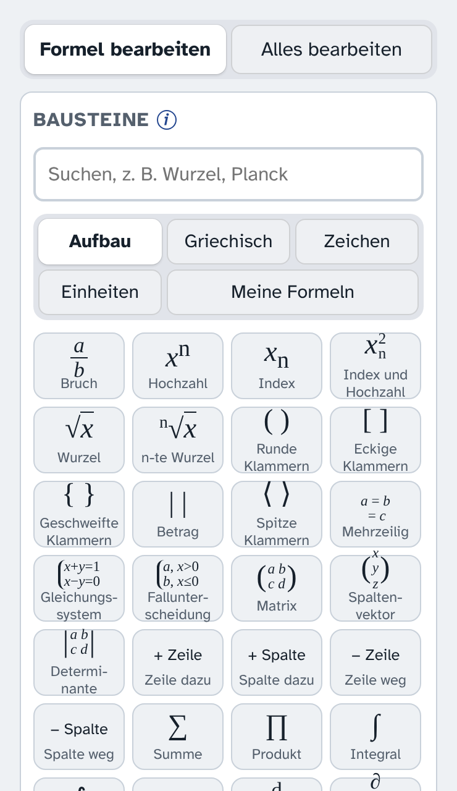
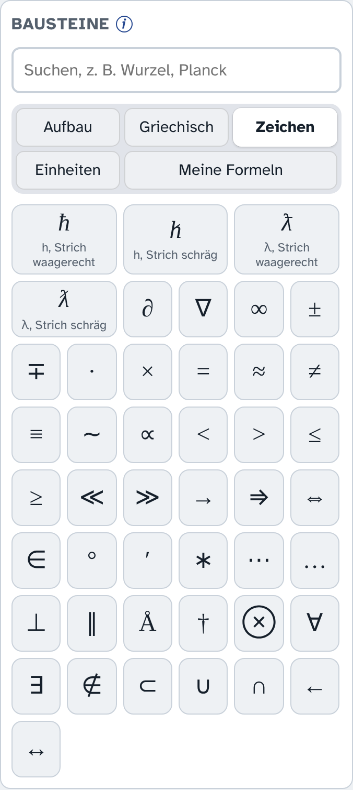
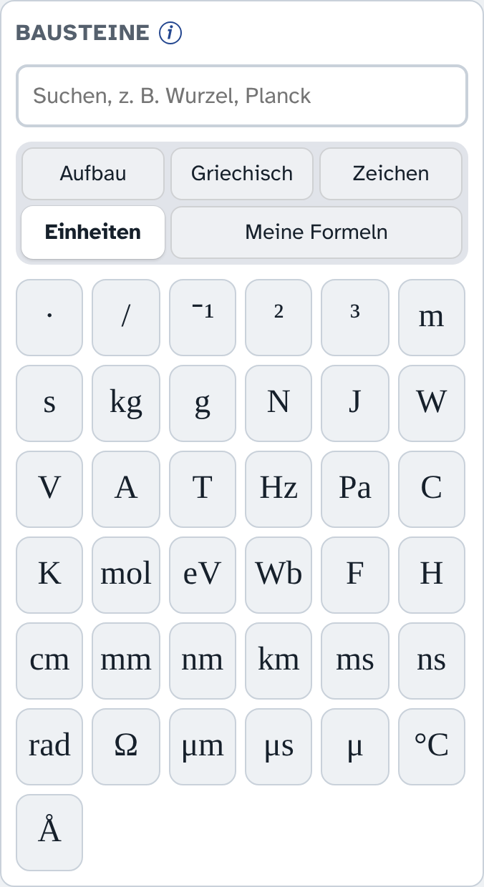
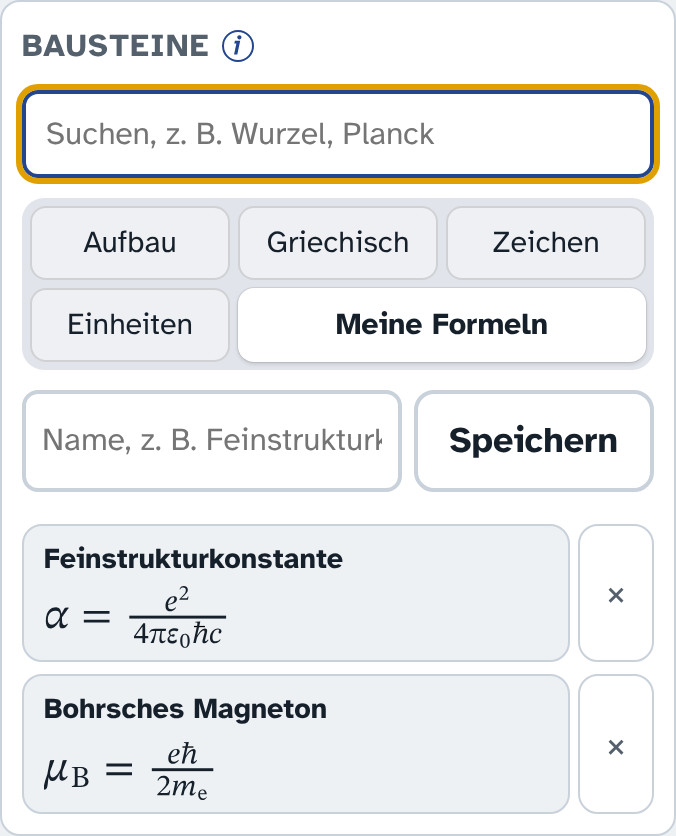
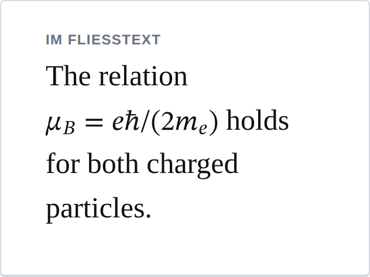
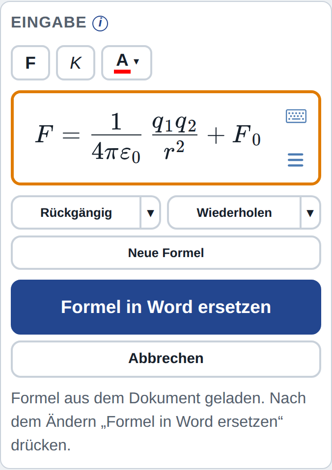
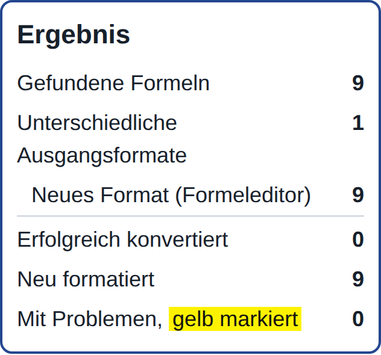
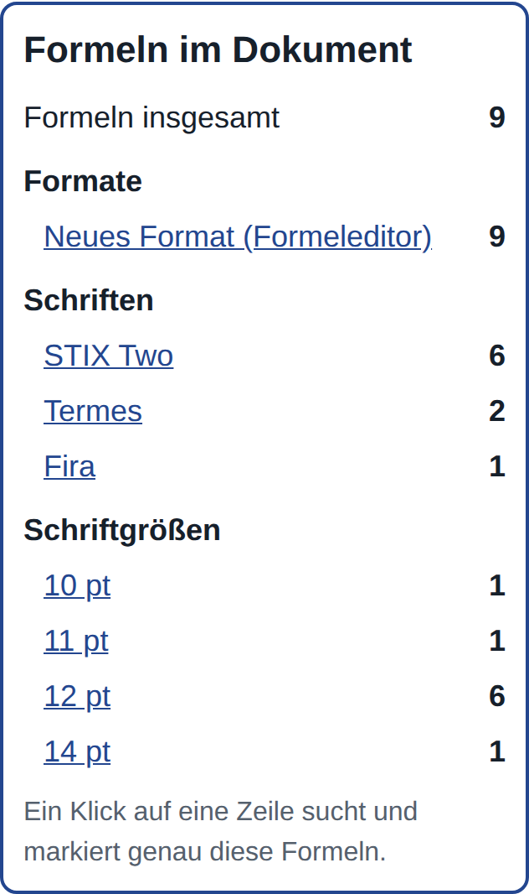
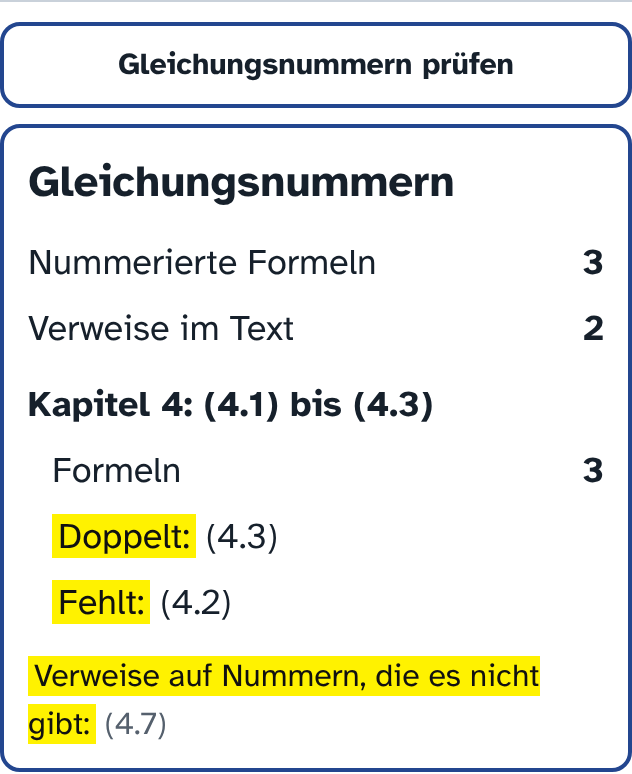

# Papas Formeleditor
: Bedienungsanleitung für Word auf dem Mac, Version 1.7.6

>> Mit dem Formeleditor entstehen mathematische und physikalische Formeln in Buchqualität direkt in Word. Man setzt die Formel aus Bausteinen zusammen oder tippt sie, sieht sofort, wie sie gedruckt aussieht, und fügt sie mit einem Klick ein. Jede Formel lässt sich später wieder öffnen und ändern.

## Auf einen Blick

Der Formeleditor öffnet sich in Word über den Knopf **Papas Formeleditor** im Reiter „Start“, ganz rechts in der Leiste. Er erscheint als Spalte am rechten Rand neben dem Dokument. Beim Öffnen ist die Eingabe leer und wartet auf eine neue Formel.

Oben gibt es zwei Reiter:

- **Formel bearbeiten:** eine einzelne Formel schreiben, einfügen oder ändern. Dieser Reiter ist beim Öffnen gewählt.
- **Alles bearbeiten:** Werkzeuge für alle Formeln im Dokument.

Darunter liegen drei Kacheln: **Bausteine**, **Eingabe** und **Ergebnis**. Ein kleines **i** hinter jeder Überschrift erklärt die Kachel, sobald man mit der Maus darauf zeigt.

Caption: Der Editor nach dem Öffnen, die Eingabe ist leer

> Tipp zur Breite. Die Spalte des Editors lässt sich mit der Maus an ihrem linken Rand breiter ziehen. Ist sie sehr schmal, rutschen die Knöpfe unter der Eingabe in eine zweite Reihe. Sie bleiben aber immer vollständig lesbar.

## Eine Formel schreiben

### Mit den Bausteinen

Unter **Aufbau** liegen Brüche, Wurzeln, Klammern, Hochzahlen, Summen und Integrale. Ein Klick setzt den Baustein an der Stelle des blinkenden Strichs ein. Leere Felder, etwa Zähler und Nenner, erscheinen als kleine Kästchen und werden der Reihe nach ausgefüllt.

Für längere Formeln gibt es **Mehrzeilig** (Gleichungen untereinander, am Gleichheitszeichen ausgerichtet), **Gleichungssystem**, **Fallunterscheidung**, **Matrix**, **Spaltenvektor** und **Determinante**. Mit **Zeile dazu**, **Spalte dazu**, **Zeile weg** und **Spalte weg** passt man sie an. Dazu den Cursor in die Zeile oder Spalte setzen, um die es geht.

Unter **Griechisch** stehen alle griechischen Buchstaben, klein und groß.

Caption: Griechische Buchstaben zum Anklicken

Unter **Zeichen** finden sich Relationszeichen, Pfeile und Sonderzeichen. Ganz vorn stehen das h und das λ jeweils mit waagerechtem und mit schrägem Querstrich.

Caption: Sonderzeichen, vorn die Varianten von h und λ

Unter **Einheiten** stehen die gebräuchlichen Einheiten. Sie erscheinen aufrecht, wie es sich gehört, und hinter einer Zahl setzt der Editor von selbst den kleinen Abstand: Man tippt 9,81 und klickt dann auf m, auf ·, auf s und auf ⁻¹ … oder ².

Caption: Einheiten zum Anklicken

### Suchen und zuletzt benutzt

Über den Reitern liegt ein Suchfeld. Dort tippt man einen Namen, etwa „Wurzel“, „Integral“, „Planck“, „Ohm“ oder „alpha“, und sieht sofort die passenden Bausteine. Das kleine × leert das Suchfeld wieder.

Caption: Die Suche nach „planck“ findet beide h mit Querstrich

Unter den Reitern erscheint die Zeile **Zuletzt** mit den zuletzt benutzten Bausteinen.

### Meine Formeln

Häufig gebrauchte Formeln lassen sich aufheben. Die Formel in die Eingabe schreiben, den Reiter **Meine Formeln** öffnen, einen Namen eintragen und auf **Speichern** klicken. Ist in der Eingabe etwas markiert, wird nur dieser Teil gespeichert. Ein Klick auf eine gespeicherte Formel setzt sie an der Stelle des Cursors in die Eingabe ein. Das × daneben löscht sie nach einer Rückfrage.

Caption: Zwei gespeicherte Formeln

### Mit der Tastatur

Buchstaben und Zahlen tippt man einfach in die Eingabe. Einige Tasten haben eine besondere Wirkung:

| Taste | Wirkung |
|---|---|
| `/` | macht einen Bruch, das Getippte wird zum Zähler |
| `^` | beginnt eine Hochzahl |
| `_` | beginnt einen Index (tiefgestellt) |
| Pfeiltasten | wechseln zwischen Zähler, Nenner und den übrigen Feldern |
| Leertaste | kleiner Abstand zwischen Ziffern, etwa 1.159 652 180 46 |
| Rückschritt | löscht das Zeichen links vom Cursor |

Caption: Tasten mit besonderer Wirkung in der Eingabe

Nach einem Komma entsteht kein Abstand. Man schreibt also 1,5 und erhält 1,5 und nicht 1, 5.

### Die Knöpfe unter der Eingabe

Unter der Eingabe liegen **Rückgängig**, **Wiederholen** und **Neue Formel**. Neue Formel leert die Eingabe. Darüber liegen die Knöpfe **F** (fett), **K** (kursiv oder aufrecht) und **A** (Farbe).

Caption: Eingabe mit Formel, darüber F, K und A, darunter die Knöpfe

### Fett, kursiv und Farbe

Zeichen in der Eingabe mit der Maus markieren und dann auf **F**, **K** oder **A** klicken. Ohne Markierung gilt die Wahl für die nächsten getippten Zeichen. **A** öffnet fünf Farben: Schwarz, Rot, Grün, Hellblau und Blau.

Caption: Die Farbauswahl hinter dem Knopf A

## Einfügen in Word

Die Kachel **Ergebnis** zeigt die Formel so, wie sie gedruckt aussieht. Darunter wählt man das Aussehen:

- **Wissenschaftlich** setzt Brüche übereinander, wie in Fachzeitschriften. Richtig für abgesetzte Gleichungen.
- **Kompakt** setzt Brüche ebenfalls übereinander, aber kleiner und flacher. Richtig für Formeln mitten im Text, weil die Zeile dann kaum höher wird.
- **Einzeilig** schreibt Brüche mit Schrägstrich, also hc/λ. So passt die Formel ganz flach in eine Textzeile.
- **Vorschau vergrößern** ändert nur die Ansicht, nicht die Formel im Dokument.
- **Schrift** und **Schriftgröße** gelten für die Formel im Dokument. Am besten dieselbe Größe wie der Text, meist 12 pt.

Caption: Die Kachel Vorschau, hier in der Darstellung Kompakt

Caption: Dieselbe Formel in einzeiliger Darstellung

So kommt die Formel ins Dokument:

- Im Dokument an die Stelle klicken, an der die Formel stehen soll.
- Auf **In Word einfügen** klicken.

### Mit Gleichungsnummer

Unter den Darstellungen steht immer das Kästchen **Gleichungsnummer erzeugen**. Es wirkt nur bei **Wissenschaftlich** und nur bei neuen Formeln; sonst ist es grau, und eine kurze Zeile darunter sagt, warum. Ist eine vorhandene Formel geladen, zeigt das Kästchen, ob sie eine Nummer hat; die Nummer steht dann auch in der Vorschau und bleibt beim Ersetzen erhalten. Ist es angekreuzt, schlägt der Editor die nächste Nummer vor, zum Beispiel (4.13), und schaut dafür auf die Nummern davor und danach im Dokument. Die Nummer lässt sich im Feld ändern. **Vorschlag** holt den Vorschlag zurück.

Beim Einfügen steht die Formel in einem eigenen Absatz und die Nummer rechtsbündig dahinter. Gibt es (4.13) schon und ist **Folgende Nummern weiterzählen** angekreuzt, macht der Editor aus der alten (4.13) eine (4.14), aus (4.14) eine (4.15) und so weiter, auch an allen Stellen im Text, die darauf verweisen.

### Das Lineal

Oben in der Vorschau steht ein Lineal wie in Word. Es zeigt die Seite in cm, die grauen Streifen links und rechts sind die Seitenränder des Dokuments. Zwei kleine Dreiecke darunter lassen sich mit der Maus verschieben:

- Das **blaue Dreieck** legt fest, wo die Formel beginnt, gemessen vom linken Rand.
- Das **orange Dreieck** legt fest, wo die Gleichungsnummer endet, gemessen ebenfalls vom linken Rand. Bei **Nummer endet bei 13,5 cm** steht die schließende Klammer der Nummer genau bei 13,5 cm auf dem Lineal.

Darunter stehen beide Werte in cm. Man kann sie dort auch eintippen.

Ist **Werte für Formel übernehmen** angekreuzt, kommt jede neue abgesetzte Formel gleich beim Einfügen an diese Stelle, ohne weiteren Knopf. Auch eine geladene Formel rückt beim Ersetzen dorthin. Ohne Häkchen bleibt alles, wie es ist. Eine Formel mitten im Fließtext wird nie eingerückt.

Das Lineal erscheint bei der Darstellung **Wissenschaftlich**, auch wenn eine vorhandene Formel zum Ändern geladen ist.

Caption: Lineal mit Formel ab 2 cm und Nummer endet bei 15 cm

Der Knopf **Formeln und Nummern im Dokument wie im Lineal ausrichten** setzt alle vorhandenen abgesetzten Formeln so, mit und ohne Nummer, dass Formeln und Nummern genau untereinanderstehen. Ein oranger Balken zeigt, wie weit er ist; am Ende steht **Ausrichtung abgeschlossen**. Am besten vorher eine Kopie des Dokuments speichern.

> Gut zu wissen. Die Nummer ist normaler Text in Word. Sie lässt sich dort auch von Hand ändern.

Es gibt acht Schriften. STIX Two passt am besten zu Times New Roman. Termes ist ebenfalls Times-ähnlich, nur zarter. Computer Modern ist der klassische Look mathematischer Bücher. Pagella, Schola und Bonum sind Buchschriften. Fira und DejaVu sind Schriften ohne Serifen.

## Eine Formel ändern

### Grüner und oranger Rahmen

1. Die Formel im Dokument einmal anklicken.
2. Sie erscheint in der Eingabe mit einem **grünen Rahmen**. Grün heißt: Die Formel ist genau so wie im Dokument.
3. Solange nichts geändert ist, heißt der große Knopf **Ohne Änderung übernehmen**. Er wandelt eine alte Formel unverändert ins neue Format um.

Caption: Geladene Formel mit grünem Rahmen

Sobald man etwas ändert, wird der Rahmen **orange**. Die Änderung ist dann noch nicht in Word. Der Knopf heißt jetzt **Formel in Word ersetzen**. Nach dem Klick steht die neue Formel an derselben Stelle, und der Rahmen ist wieder grün.

Der Knopf **Abbrechen** darunter wird jetzt aktiv. Er verwirft alle Änderungen, und die Formel steht wieder so in der Eingabe wie im Dokument.

Caption: Geänderte Formel mit orangem Rahmen, Ersetzen und Abbrechen

> Gut zu wissen. Soll statt des Ersetzens eine zusätzliche Formel entstehen, vorher auf „Neue Formel“ klicken. Dann heißt der große Knopf wieder „In Word einfügen“.

### Der Verlauf

Der kleine Pfeil neben **Rückgängig** zeigt die letzten 20 Schritte, jeweils mit einem Kästchen zum Ankreuzen.

- **Rückgängig machen** nimmt die angekreuzten Schritte zurück, auch wenn danach weitergearbeitet wurde.
- Der Pfeil neben **Wiederholen** zeigt dieselben Schritte. **Anwenden** bringt angekreuzte Schritte zurück oder überträgt sie auf eine andere Formel, zum Beispiel „v fett“ auf die nächste angeklickte Formel.
- Passt ein Schritt nicht zur Formel, wird er ausgelassen, und der Editor sagt das.

Caption: Der Verlauf mit den letzten Schritten

## Alles bearbeiten

Der zweite Reiter arbeitet mit allen Formeln im Dokument.

Caption: Der Reiter Alles bearbeiten

- **Standard für dieses Dokument:** Schrift und Schriftgröße für das Konvertieren und Formatieren.
- **Alle Formeln konvertieren:** wandelt alte Formeln aus dem Formel-Editor 3.0 ins neue Format um. Das Ergebnis öffnet sich als neues Dokument, das man mit „Speichern unter …“ sichert. Das Original bleibt unverändert. Problemfälle sind gelb markiert und müssen neu eingegeben werden.

Caption: Die Übersicht nach dem Konvertieren

- **Formeln im Dokument analysieren:** zählt die Formeln nach Format, Schrift und Schriftgröße. Ein Klick auf eine Zeile sucht genau diese Formeln.

Caption: Analyse der Formeln im Dokument

- **Gleichungsnummern prüfen:** zeigt für jedes Kapitel, ob Nummern doppelt vorkommen, fehlen oder durcheinander stehen, und ob der Text auf eine Nummer verweist, die es nicht gibt.

Caption: Prüfung der Gleichungsnummern

- **Formeln suchen:** markiert passende Formeln türkis. Mit **Zurück** und **Weiter** springt man von Formel zu Formel, formatiert sie einzeln oder alle im Standard und entfernt am Ende die Markierungen.

Caption: Suchen, blättern und formatieren

## Version und Hilfe

### Version und Aktualisierung

Unten im Editor stehen Name und Version. Das **Zahnrad** daneben öffnet die Einrichtung.

Caption: Die Fußzeile mit Version, Problem melden und Zahnrad

Die Einrichtung vergleicht die Version mit der neuesten. Gibt es eine neuere, erscheint beim Start oben ein blauer Hinweis. Mit **Ja, jetzt aktualisieren** holt sich der Editor die neue Version. Eine noch nicht eingefügte Formel bietet er danach wieder an. **Dokumentation herunterladen** öffnet diese Anleitung.

Caption: Die Einrichtung mit Versionsprüfung

### Eine Formel ist nicht verloren

Der Editor merkt sich die Formel in der Eingabe laufend. Wird er geschlossen, bevor sie in Word steht, oder stürzt Word ab, zeigt er sie beim nächsten Öffnen oben an.

Caption: Eine noch nicht eingefügte Formel wird angeboten

- **Wiederherstellen** holt sie in die Eingabe zurück. Gehörte sie zu einer Formel im Dokument, diese Formel einmal anklicken. Dann ersetzt der große Knopf genau sie.
- **Verwerfen** lässt sie weg.

### Problem melden

Sieht eine Formel falsch aus oder klappt etwas nicht, unten auf **Problem melden** klicken. In das Feld kurz schreiben, was nicht stimmt. Beim ersten Mal die E-Mail-Adresse eintragen, an die die Meldung gehen soll. Der Editor merkt sie sich.

**E-Mail vorbereiten** öffnet das E-Mail-Programm mit einer fertigen Nachricht. Darin stehen die Beschreibung, die Formel aus der Eingabe und die Version. Dann nur noch auf „Senden“ klicken. Öffnet sich nichts, **Text kopieren** drücken und den Text mit ⌘V in eine neue E-Mail einfügen.

Caption: Das Fenster Problem melden

### Wenn etwas nicht klappt

| Was passiert | Was hilft |
|---|---|
| Der Knopf Formeleditor fehlt | Word ganz beenden (⌘Q) und neu starten |
| Der Editor bleibt leer oder lädt nicht | Internet prüfen, Editor schließen und neu öffnen |
| Die angeklickte Formel erscheint nicht | Formel noch einmal anklicken |
| Eine Formel ist zu klein | Größere Schriftgröße wählen und ersetzen |
| Die Knöpfe stehen in zwei Reihen | Die Editorspalte breiter ziehen |

Caption: Kleine Hilfe bei Problemen

Für die Formeln im Dokument braucht Word kein Internet. Der Editor bringt alle Schriften selbst mit und braucht Internet nur, um sich beim Öffnen zu laden. Den Alternativtext einer Formel bitte nicht von Hand ändern, denn darin merkt sich der Editor die Formel für spätere Änderungen.
